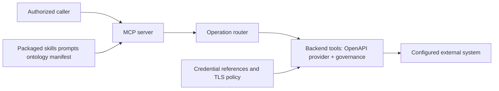

# Connector architecture

The `craft-suite-api` package serves every backend API operation as one typed tool. Graph ingestion is unavailable until a scoped source mapping is implemented.
The [shared connector SDK](https://github.com/Knuckles-Team/scion-sdk/blob/b9ee9ed0a82f6ecd5ed23d6226ca5ab503f74f9c/README.md) owns reusable runtime contracts.

## Source and verification map

| Boundary | Source | Verification target |
|---|---|---|
| MCP entry and routing | `craft_suite_api/mcp_server.py`, `craft_suite_api/mcp/__init__.py` | `tests/test_artcraft_mcp_validation.py` |
| One typed tool per backend operation | `craft_suite_api/backend.py`, `craft_suite_api/backend_spec.py`, `craft_suite_api/api_spec/` | `tests/test_backend_tools.py` |
| Write governance and audit | `BackendGovernance` in `craft_suite_api/backend.py`, SDK confirmation helper | `tests/test_backend_tools.py`, `tests/test_destructive_confirmation_transports.py` |
| Credentials, TLS and bounded requests | `craft_suite_api/auth.py` | `tests/test_auth.py`, `tests/test_api_wrapper.py` |
| Withheld ingestion | No callable ingestion module | `tests/test_source_contract.py` verifies the starter cannot be imported |

The [capability specification](https://github.com/Knuckles-Team/craft-suite-api/blob/main/specs/craft-suite-api/spec.md)
defines the planned behavior and acceptance targets.
The [delivery dashboard](https://knuckles-team.github.io/craft-suite-api/spec-delivery/)
shows source-backed records, code mappings, and declared relationships.
Its architecture download preserves the declared spec graph without inferring dependencies from shared code.

The generated source does not prove live service behavior, published artifacts, or deployed operation.
